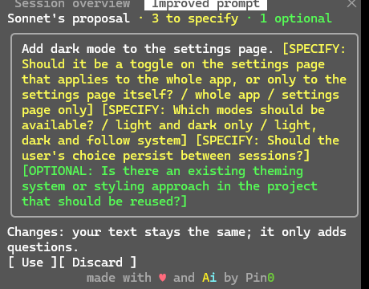

# pin0-claude-plugins

**English** · [Español](README.es.md)

Mods and plugins for [Claude Code](https://code.claude.com) that I use every day and decided to share. Each one lives in its own folder under `plugins/`, with its own README.

## What's here

| Plugin | What it does |
| --- | --- |
| [consejero-modelo](plugins/consejero-modelo) | While you write the first prompt of a session, a line above the prompt suggests a model and effort. On any prompt, `Improve` asks a model for a better version and shows it in a pane, with tags for what only you can answer. It speaks Spanish or English, following your draft. |
| [session-overview](plugins/session-overview) | A pane beside the chat with the session's model, effort, cost and time, the folder, branch and worktree, how full the context window is, how much of the 5-hour and weekly limits is left, and the files the session created or modified, each one a click away in VS Code. |



## Installing a plugin

Type this at the Claude Code prompt, with the plugin's name:

```text
/plugin install consejero-modelo --marketplace jpinob/pin0-claude-plugins
```

Answer `y` to add the marketplace, then pick a scope. Once the marketplace is added, the other plugins here install the same way.

These are mods: they draw in Claude Code's own interface (bands, panes, the prompt box). They were built and tested on Claude Code 2.1.328. The mods API is in early access, so a newer version may break something.

## License

[MIT](LICENSE).
