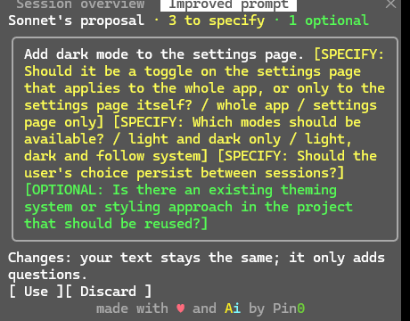

# consejero-modelo

**English** · [Español](README.es.md)

While you write the first prompt of a session, this mod looks at what it is about and tells you in one line which model and effort it would use:

```
Advice: Fable · medium · architecture   [Apply] [Improve] [Turn off]
```

It only suggests. It never changes the model or the effort on its own: it does so when you press `Apply`. Your prompt is always sent exactly as you wrote it.

On any prompt, the `Improve` button also asks a model for a better version of what you wrote and shows it in a pane, next to a model and effort card for that same draft. You pick what to use, and you press Enter yourself.

Current version: **0.8.7** (in `.claude-plugin/plugin.json`).



## Language

The mod speaks Spanish or English: the band, the pane, the notices, `/consejo` and `/mejora`.

- **It follows the language you write in.** It detects it from frequent words of each language and from signs such as ñ, ¿, ¡ and accents, without calling any model. When a text gives no clue or ties, the language stays as it was.
- **Before you write anything**, it uses Claude Code's `language` setting: `spanish` or `español` means Spanish; any other value, or none, means English.
- **The proposal's tags** follow the prompt's language, whatever the interface's.
- `/consejo audit` works as well as `/consejo auditar`.

What does not change: the command names (`/consejo`, `/mejora`), the `/config` rows (shown in both languages at once) and what Haiku and the improver are asked.

## When it speaks

- On the first prompt of a new session and on the first one after `/clear`. It stays quiet when you resume a session with `/resume`.
- While you type, before you press Enter, so you can switch with `/model` or `/effort` before sending.
- Only when the advice differs from what you have set. If you switch to the suggested model, the line goes away. One exception: when Haiku reviews the draft and finds your settings right, the line says so (`Advice: you're fine with Opus · high · debugging`) instead of just vanishing.
- With fewer than 12 characters, or when the text starts with `/`, it says nothing.
- Once you send the prompt the line goes away and does not come back in that conversation.

The line shows in the band above the prompt: terminal, desktop app and mobile. VS Code has no such band, so there is no advice line and no `Improve` button there; `/mejora` works, and its pane brings the model and effort card. In `claude -p` the mod does nothing.

`/consejo` shows the last advice with the rule that triggered it, its source and the conflicts it carries, and the effort the mod knows and where it came from.

The `Improve` button follows none of these rules: it shows on any prompt with 12 characters or more that does not start with `/`. After the first prompt, the band holds that button alone.

## Taking the advice

The line has two buttons of its own: `Apply` and `Turn off`. Click them, or focus the band with `ctrl+x tab` and press their key.

`Apply` writes the suggested model and effort into their `/config` rows, as if you changed them in the menu yourself. Your prompt stays in the box: all that is left is Enter. A short notice says what was applied.

Two things to know. Changing the model from `/config` may save it as the default model for new sessions. When `/config` has no effort row, the mod runs `/effort <level>` as you would, and that saves the level as the model's default for later sessions; `Undo` puts back the level you had, or runs `/effort auto` when it was the model's own default. And if the engine refuses the change, the notice says so and you will have to use `/model` or `/effort`.

`Turn off` switches the advisor off for the whole session, `/clear` included: no advice and no Haiku calls. On the first prompt the band then says "Advisor off" and offers `Turn on`, which brings the advice back for the draft in the box. The `Improve` button stays either way.

## Improving the prompt

Press `Improve` in the band, or type `/mejora`. This is what happens:

1. A model gets your draft and the `improver` instructions in `rules.ts`. Sonnet by default.
2. The "Improved prompt" pane opens. **Your box does not change yet.**
3. The pane holds two cards, each in its own frame:
   - **Prompt.** The proposal, with how many tags of each level it leaves. Below it, one line with the changes: how many words were added and which of yours were dropped. The mod works it out by comparing both texts, without asking the model, so a dropped word cannot be hidden. A capital letter or a full stop is no change. If the proposal runs longer than allowed, a yellow line says so.
   - **Model and effort.** Haiku's suggestion for that same draft: one row for the model and one for the effort, only the ones that would change. It is explained in [Model and effort in the pane](#model-and-effort-in-the-pane).
4. Every card and every row has `Use`, in your theme's green, and `Discard`. They only record your pick; nothing changes yet.
5. Once every row has a pick, `Prepare` shows up below the cards. It applies what you picked: the proposal goes into the box, and the model and effort go into their `/config` rows. It never sends anything.
6. After `Prepare`, the pane keeps one line with what was applied and what was discarded, for example `Applied: prompt in the box, model Fable. Discarded: effort.`: the notice goes in seconds, and VS Code shows the model nowhere. `Undo` puts back exactly what the box held, and the model and effort you had.
7. Above the foot, the version of the copy that runs (`consejero-modelo v0.8.7`): an installed plugin runs from a copy, which can lag behind the folder you unzipped. At the foot, the signature "made with ♥ and Ai by Pin0", in the colours of your light or dark theme. In a narrow pane it is short: "♥ Ai Pin0".

After `Prepare` the band says nothing, not even `Improve`, until you send the prompt: you have already decided for that draft. `/mejora` still works if you need it. `Undo` brings the band back.

### Tags by importance

The model may not invent or assume anything, not even marked as doubtful. Where something is missing, it leaves a tag with a question:

| Colour | In Spanish | In English | Meaning |
| --- | --- | --- | --- |
| Red | `[NECESARIO: …]` | `[REQUIRED: …]` | Only you know it, and without it the model would have to guess: what you want, what you see failing |
| Yellow | `[ESPECIFICAR: …]` | `[SPECIFY: …]` | Only you know it, and it changes the result: scope, limits, cases |
| Green | `[OPCIONAL: …]` | `[OPTIONAL: …]` | The assistant can find it by reading the code: files, modules, names. Saying it saves time |

A question may carry 2 or 3 short options to make it quick to answer. The colour never goes alone: the word says the level, and a screen reader reads it. The colours are the theme's (`error`, `warning`, `success`), so they follow your light or dark mode. At most 4 tags, the most important ones.

When `Prepare` puts the proposal in the box, the tags are painted there too, and stay painted while you type.

### Short

Tags left out, the proposal may not go past twice your draft's words, or 25 more words when the draft is very short. The numbers are in `rules.ts` (`maxLengthFactor`, `minExtraWords`, `maxTags`), and the instruction the model gets takes them from there. If the model goes past them, the pane says so.

The mod never sends anything: you review the box and press Enter. When you send a prompt, the proposal is forgotten and the pane closes.

`/mejora text` improves the text you put after it. A bare `/mejora` improves the last draft you wrote in this conversation, sent or not.

The model's instructions are in `rules.ts`, each with its source. The main ones: keep your intent and your language, keep a question a question, drop nothing you asked for, add no facts you did not give, and add no steps or "verify" or "think carefully" reminders. The last two come from the [model docs](https://code.claude.com/docs/en/model-config): "Describe the outcome, not the steps" and "Skip the verification reminders".

### Who rewrites and what it costs

`/config`, row "Who rewrites the prompt / Quién reescribe el prompt": `sonnet` (default) or `haiku`. Each press is one paid call, at effort `low`. If you cancel, an answer that arrives late is not shown.

With the [November 2026 prices](https://platform.claude.com/docs/en/about-claude/pricing), estimated at 1,500 input tokens and 500 output tokens: Sonnet 5.5 about $0.008, Haiku 5.5 about $0.0004. The caps are 4,000 draft characters and 3,000 reply tokens: with Sonnet, about $0.035 at most. These are estimates; `/cost` shows the real spend. On a subscription it counts against your usage limit.

#### Sonnet or Haiku: what was measured

On 19 Nov 2026, six of my real prompts went through both models five times: three with the 0.7.3 instructions and two with those of 0.7.4 (`claude -p`, the same system prompt as the mod, effort `low`). Averages over 30 calls per model:

| | Sonnet 5.5 | Haiku 5.5 |
| --- | --- | --- |
| API time | 2.4 s | 3.1 s |
| Cost per press | $0.007 | $0.0005 |
| Output tokens | 200 | 520 |
| Over the length cap | 0 | 0 |

Both kept the intent and stayed under the cap. Haiku mislabels more often: it marks as `[OPTIONAL]` what only you know, and it once turned an English prompt into Spanish. That is why `sonnet` stays the default. The quality reading is mine, from reading the proposals; time and cost come from the API.

The model sees only your draft: neither your CLAUDE.md nor your repo. That is why it may not add facts and leaves tags instead.

## Model and effort in the pane

The card follows the same rules and the same Haiku as the band, with one difference: it also works after the first prompt.

- **First prompt.** Model and effort, as the band would advise them. If the band's Haiku already read that very draft, the card uses its answer and makes no second call.
- **After the first prompt.** The model row comes with a warning in red: switching models mid-session breaks the cache, and the new model re-reads the whole conversation uncached. The warning gives the tokens it would re-read, as the status line counts them.
- **Effort up:** as far as the rules ask, on any prompt. Without an effort row, the card says why: the effort stays, it is not lowered, or the mod cannot read it from `/config`.
- **Effort down after the first prompt:** one level at most, and only when Haiku reads the draft as a new task and the last turn ended without tool errors. Otherwise the card says it stays where it is and why. The classifier sees one draft, and "ok, go on" in the middle of a migration reads as easy: a wrong lower is the costly mistake.

### The task memory

A conversation can hold several tasks: "migrate the database", then "yes", "yes", "yes", then "now write the README". A short "yes" says nothing about the task, so after the first prompt Haiku gets some context:

- The task in progress: the last draft Haiku read as a task of its own. The first prompt always starts one.
- The last five prompts you sent, 300 characters each at most.
- The end of the assistant's last reply, 1,000 characters at most (`effortLater.contextChars` in `rules.ts`).
- How the last turn went, as counts: tools, file edits, errors. Never the tools' output.

Haiku answers for the task as it stands, and says whether the draft starts a new one. A "yes" inherits its task's classification. `/clear` forgets the task. With `palabras` there is no Haiku to read the context: after the first prompt the card proposes nothing unless a word of the rules matches, and it never lowers the effort.

Each `Improve` press after the first prompt is one Haiku call with that context: about 2,000 input tokens, some $0.0002 at Haiku 5.5 prices. An estimate; `/cost` shows the real spend.

## Who classifies

There are two classifiers, and they work together:

- **The words.** As you type, the mod looks for the words of `rules.ts` in your text, Spanish and English alike. It is free and instant, but it errs when a word is used in another sense. "Yesterday's migration broke the login" has Fable's word, and what it asks for is debugging. That is why, with Haiku on, the words' guess is never shown and never applied.
- **Haiku.** When you stop typing for 1.2 seconds, the mod hands the draft to Haiku and asks it to pick among the same rules. Until it answers, the band says `Advice: Haiku looks once you stop typing` or `Advice: Haiku looking…`, with no `Apply`. Its answer is the advice. While you keep typing on the same text, Haiku's answer stays.

Haiku is a small paid call. The brakes:

- Only on the conversation's first prompt, which is when the mod speaks.
- Never per key: it needs the pause. If you type again, the call in flight is cut and does not count.
- No cap on calls, but none repeated for the same text. Each new draft you pause on is one call.
- Only the first 2,000 characters of the draft and the list of rules are sent. The pane's card, after the first prompt, adds the context described in [The task memory](#the-task-memory).

At Haiku 5.5 prices ($0.10 per million input tokens and $0.50 output), each call costs about $0.00015: ten pauses on ten different drafts, about $0.0015. That is an estimate at about 1,200 input tokens; `/cost` shows the real spend. On a subscription it counts against your usage limit.

Haiku can only pick a rule that exists. If it answers anything else, fails or takes more than 8 seconds, there is no advice for that draft and the band says why: `Haiku did not answer; no advice` or `Haiku answered something unusable; no advice`. `/consejo` says who classified.

Haiku's advice ends in `· per Haiku`. If Haiku is asked again on a longer draft, its earlier line stays with `· Haiku looking…` until the new answer. `/consejo` gives the reason for a failure.

To keep only the words, with no model call: `/config`, row "Who classifies the prompt / Quién clasifica el prompt", value `palabras`. The numbers (pause, time limit, characters) are under `haiku` in `rules.ts`.

## Why only on the first prompt

Each model has its own prompt cache. Switching models mid-session makes the next request read the whole conversation again with no cache hits. With 100,000 tokens of context and the one-hour cache, moving to Opus 5.5 costs about $0.80 against $0.02 for a normal read. On the first prompt there is no conversation to read again yet. The pane's card does propose a model later on, with that cost in a red warning: see [Model and effort in the pane](#model-and-effort-in-the-pane).

Effort is a different story: with a subscription or an API key, changing it keeps the cache on Fable 5.1 or later, Opus 5.5, Sonnet 5.5 and Haiku 5.5.

Sources: [prompt caching in Claude Code](https://code.claude.com/docs/en/prompt-caching) and the [price table](https://platform.claude.com/docs/en/about-claude/pricing), read on 18 November 2026.

## The rules

They live in [`rules.ts`](rules.ts), a file that holds data only. The mods engine does not import `.json`, hence `.ts`. You edit it the same way: change values and save.

- `models`: each rule has an `id`, the `model`, a short `reason` in both languages, its `words` and its `source`.
- `efforts`: the same for effort.
- `defaultModel` and `defaultEffort`: what is proposed when no rule fits.
- `effortStep`: the rule "before a bigger model, raise the effort". `ceiling` is the effort from which the model is proposed instead.
- `conflicts`: the points where my guide and the sources disagree, in both languages.
- `minChars`: how much text is needed to classify, and to offer `Improve`.
- `improver`: the improver's instructions, each with its `source`, and its limits: draft characters, reply tokens, time limit, effort, and the share of changed text from which it counts as rewritten (`rewriteThreshold`).

Words are written lowercase and without accents, Spanish and English in the same list. A word ending in `*` is a prefix: `migra*` matches "migrar", "migración" and "migrate". Without `*` it must appear whole: `log` does not fire on "login". What the person reads (`reason`, `support`, `conflicts`) goes as `{ "es": ..., "en": ... }`.

How it decides:

1. The model family with the most matched words wins.
2. A tie between two families is doubt, and doubt goes to the default model (Opus).
3. For effort, the rule with the most words wins; on a tie, the higher level.
4. If the rule asks for a bigger model than yours and your effort is below the `ceiling`, the line proposes one more level of effort on your current model.

### Conflicts with the sources

The model rules are my guide. The effort rules come from the [model docs](https://code.claude.com/docs/en/model-config). There are four points where my guide does not match that page or the article [Choosing a Claude model and effort level in Claude Code](https://claude.com/blog/claude-model-and-effort-level-in-claude-code). They are marked in `rules.ts` as C1 to C4, and `/consejo` shows them when the rule applied carries one. My rule stands.

## When Anthropic changes things

The rules talk about model families (Haiku, Sonnet, Opus, Fable), not versions. A new Opus needs no change.

For the rest there is an auditor. It only warns: it never changes `rules.ts`.

- **On the fly.** If your session runs a model from no family in `rules.ts`, the line says so: `· I don't know your model: try /consejo audit`.
- **`/consejo audit`.** Downloads the two pages the rules come from and checks, without calling any model, that each sentence copied into `quotes` is still there word for word, that the model table brings no new family and has lost none, and that there is no new effort level. The report shows in the conversation.
- **A model's opinion, only when there are findings.** When the check finds something, the mod gives Sonnet the rules, the findings and excerpts of the pages, and asks which rules no longer match. It is one paid call: about $0.03 at November 2026 Sonnet 5.5 prices, estimated at 10,000 input tokens. With no findings, no model is called.

What to do with a finding:

- **New family.** Add its name to `families`, in its place from smallest to largest, and give it a rule in `models`. No code to touch.
- **A quote that is gone.** Open the page, see what it says now and decide whether the rule still holds. Then fix the sentence in `quotes`.
- **An alias or a row that is neither a model nor a level.** Add it to `nonFamilyAliases` or `nonEffortLevels` so it stops warning.

The quotes were last read against their pages on 18 November 2026 (`audit.reviewed`).

## Installing it

Type this at the Claude Code prompt:

```text
/plugin install consejero-modelo --marketplace jpinob/pin0-claude-plugins
```

Answer `y` to add the marketplace, then pick a scope. To turn it off later:

```bash
claude plugin disable consejero-modelo@pin0-claude-plugins
```

To try it for one session from a clone of the repository, without installing anything:

```bash
claude --plugin-dir plugins/consejero-modelo
```

Installed from the marketplace, Claude Code uses a copy. Edits to `rules.ts` inside that copy are lost on update: edit your own clone instead.

## Tests

```powershell
claude plugin validate .
claude plugin test .
```

`hooks/classifier.test.ts` tests the rules with twenty-four example prompts: three per model in Spanish and three in English. `hooks/band.test.tsx` simulates typing key by key, sending, `/clear` and a model switch. `hooks/haiku.test.tsx` simulates Haiku and the clock: the pause, no repeated call for the same text and bad answers. `hooks/auditor.test.tsx` audits two fake pages with a quote taken out or a family added. `hooks/improver.test.ts` tests the improver's request, the reading of its reply, the tags in both languages, the length cap and the word comparison. `hooks/panel.test.tsx` presses `Improve`, `Use`, `Prepare`, `Undo` and `Cancel`, and tests `/mejora`, the failures and the tag colours in the box. `hooks/signature.test.tsx` measures the contrast of the signature's colours on light and dark backgrounds, and checks it sits at the foot of the pane, short when it does not fit, with the heart drawn outside the terminal. `hooks/i18n.test.tsx` tests language detection and that the band, the pane and `/consejo` switch language with the draft. `hooks/effort.test.ts` tests the card's rows: that a "yes" never lowers the effort, the one-level lower for a new task, the model row's tokens and the request with the task memory. `hooks/card.test.tsx` runs the card against a stand-in engine: the task memory after the first prompt, `Prepare` writing `/config`, the quiet band, `Undo`, `/clear` and the fixed colours in VS Code. `hooks/palette.test.ts` measures those colours. No test calls a real model.

## Known limits

- The engine has no call to read the session's effort, and `/effort` does not show in the `/config` row. The mod follows Claude Code's own order ([model docs](https://code.claude.com/docs/en/model-config), read 19 November 2026): the `CLAUDE_CODE_EFFORT_LEVEL` variable; what this session showed (the level reported at the end of each turn, a `/effort <level>` typed, a `/config` change); the level saved for the model under `modelSettings`; a top-level `effortLevel`; the `/config` row; and the model's own default, `medium` for the models listed in `defaultEffort.models` in `rules.ts`. It cannot see `--effort` at launch until the first turn ends. `/consejo` says which source it used.
- It does not look at `flujo-plan`'s state, which picks a model per step. With a step active, the line compares against your session's model, not the one that will answer.
- The Haiku part is tested with simulated answers. What the real Haiku answers, and how often it is right, shows in use. That goes for the task memory too: whether Haiku tells a "yes" from a new task is untested on real prompts.
- In VS Code the theme colours do not show, so the pane uses the signature's fixed colours there, measured at 4.5:1 on VS Code's backgrounds. The colours of the tags in the prompt box itself stay the theme's.
- The improver's tests use simulated answers. The Sonnet and Haiku comparison above is six prompts and five runs: a small sample.
- Closing the pane yourself (with Escape or its close mark) forgets the proposal. No test covers it: the test kit cannot simulate that close.
- `Improve` and `/mejora` open the pane at any terminal width. If the engine still cannot place it (no surface draws panes), the mod makes no call and a notice says why.
- Language detection works by words. A short draft with no frequent words or accents ("Postgres MySQL") does not change the language.
- The signature "made with ♥ and Ai by Pin0" sits at the foot of the "Improved prompt" pane and at the end of `/consejo`. It does not fit in the band, which is a single line.

## Versions

- **0.8.7**: with no effort row in `/config` (Javi's case), `Prepare` and `Apply` run `/effort <level>`, and `Undo` puts the effort back; the version above the signature comes from the code, since reading the manifest showed nothing on Windows.

- **0.8.6**: the effort is read in Claude Code's own order, the level `/effort` saves under `modelSettings` and the model's default included; `/effort` saves there and never reached the mod in 0.8.5 (seen by Javi).

- **0.8.5**: `/effort <level>` is read as the command runs; the mod listened for it where the built-in command never shows (seen by Javi on 0.8.4).

- **0.8.4**: the pane shows the version of the copy that runs; `/consejo` says which effort the mod knows and where it came from.

- **0.8.3**: the effort is read from `/effort <level>`, from `/config` and from the end of each turn, since `/effort` does not show in the `/config` row (seen by Javi in VS Code and in the terminal).

- **0.8.2**: the card never stays silent about the effort: without an effort row it says the effort stays, why it is not lowered, or that it cannot read it from `/config`.

- **0.8.1**: after `Prepare` the pane keeps a line with what was applied and discarded (the notice went too fast, and VS Code shows the model nowhere); checked by Javi in VS Code: `Prepare` does change the model there.

- **0.8.0**: the pane has two cards, prompt and model and effort, each with `Use` and `Discard`, and `Prepare` applies the picks; after the first prompt the card proposes the model with a red warning about the cache, raises the effort freely and lowers it one level only for a new task after a clean turn; a task memory so a run of "yes" keeps its task; after `Prepare` the band is quiet until the next send; fixed colours in VS Code.
- **0.7.5**: `/mejora` opens the pane in a narrow terminal too (before, under 144 columns it stayed undrawn); `/consejo` and `/mejora` are registered in sessions that are not the terminal's REPL, such as VS Code's.
- **0.7.4**: improver instructions from a real Sonnet and Haiku comparison: a question stays a question, the proposal and its tags follow the prompt's language, "this file" with nothing pasted asks for it, a preference is never `[OPTIONAL]`, and a clear question gets no `[REQUIRED]`.
- **0.7.3**: `Turn off` now really survives `/clear` (it came back on in a real session).
- **0.7.2**: `Turn off` / `Turn on` replace `Hide`, with "Advisor off" in the band; with Haiku on, the words' guess is never shown or applied.
- **0.7.1**: no cap on Haiku calls, so the band no longer goes silent after a few drafts; `Use` in green.
- **0.7.0**: the mod speaks Spanish or English, following your draft; reasons, conflicts and classifier words in both languages; README in English and Spanish.
- **0.6.5**: tag questions may carry 2 or 3 short options; the band is no longer dimmed.
- **0.6.4**: when the text stays the same but tags were added, the pane no longer says the prompt was clear.
- **0.6.3**: the signature "made with ♥ and Ai by Pin0" at the foot of the pane, in the theme's colours.
- **0.6.2**: the code moves to English (files, names and `rules.ts` keys, formerly `reglas.ts`). The only visible change: messages that named `reglas.ts` now say `rules.ts`.
- **0.6.1**: buttons under the proposal; green becomes what the assistant can find out alone; one-line questions.
- **0.6.0**: `[NECESARIO]`, `[ESPECIFICAR]` and `[OPCIONAL]` tags (and their English forms) coloured in the pane and the box; the model may not assume; a length cap; buttons on top; a short change summary; no dimmed text in the pane.
- **0.5.0**: the `Improve` button and the `/mejora` command, with the "Improved prompt" pane and the "Who rewrites the prompt" row in `/config`.
- Earlier versions (up to 0.4.0) have no notes here.
