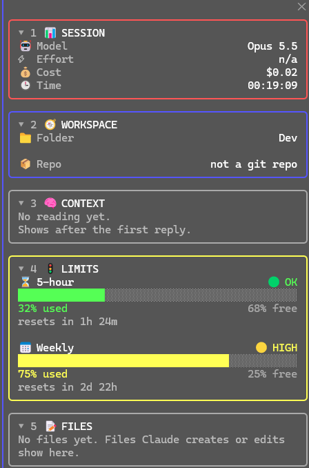

# session-overview

A Claude Code mod that keeps a small pane next to the chat with what I kept checking by hand: which model and effort I'm on, what the session has cost, how full the context window is, how much of the 5-hour and weekly limits is left, and which files the session created or modified, each one a click away in VS Code.



```
▾ 1  📊 SESSION
  🤖 Model            Opus 5.5
  ⚡ Effort       high ▰▰▰▱▱
  💰 Cost                $1.84
  🕒 Time             00:42:17
▾ 2  🧭 WORKSPACE
  📁 Folder            my-app
  📦 Repo         acme/my-app
  🌿 Branch        feat/login
  🌳 Worktree         primary
▾ 3  🧠 CONTEXT        🟡 HIGH
  ██████████████████┃░░░░░░░░
                            ▲
  72% used           28% free
  ┃ /compact 70% · ▲ auto 97%
  💡 Consider /compact now
▾ 4  🚦 LIMITS
  ⌛ 5-hour 28% used, resets in 3h 12m
  📅 Weekly 92% used, resets in 2d 5h
▾ 5  📝 FILES
  A src/login/form.tsx
  M README.md
  M package.json
  A created · M modified · click to
  open in VS Code
```

## Install

Type this at the Claude Code prompt:

```text
/plugin install session-overview --marketplace jpinob/pin0-claude-plugins
```

Answer `y` to add the marketplace, then pick a scope. To try it for one session from a clone of the repository, without installing anything:

```bash
claude --plugin-dir plugins/session-overview
```

## Using it

- The pane opens by itself when the terminal is in fullscreen and wide enough (about 144 columns). Below that, type `/overview` to open or close it.
- Each card folds to a one-line summary. Click its header, or focus the pane (`ctrl+x` then `tab`), move to the header and press Enter. The pane remembers which cards you folded.
- Colours follow your Claude Code theme. Green is under 70%, yellow from 70%, red from 90%, and every level also carries a word (OK, HIGH, CRITICAL).

## The files card

- It lists every file Claude wrote in this session with the Write, Edit or NotebookEdit tools, subagents included. The newest is on top.
- **A** means the session created the file. **M** means it changed a file that was already there. A file the session created stays **A** after later edits.
- Paths inside the session's folder show relative to it. Others show in full.
- Click a row, or move to it and press Enter, to open the file in VS Code. Folded, the card shows a count such as `2 new · 3 modified`.
- Opening runs `code --goto <file>` on the machine where Claude Code runs. **The `code` command must be on your PATH.** On macOS, run "Shell Command: Install 'code' command in PATH" from VS Code's command palette once. On Windows the installer adds it.
- If VS Code can't be started, a toast says so. On Windows, a file name with `& | < > ^ % !` is not opened, because `cmd.exe` would treat those characters as commands.
- Files changed only through Bash commands (`mv`, `sed -i`, a generator) are not listed: the pane sees the file tools alone.
- The list belongs to the session. It survives `/reload-plugins`, not a new session.

## What the context bar marks

- **`┃` (red)**: where it's a good moment to run `/compact`. 70% by default; change it in `/config` under "Suggest /compact at (%)".
- **`▲` (yellow)**: where Claude Code will compact on its own.

## Good to know

- The 5-hour and weekly limits only show on a subscription plan, and only after the first reply of the session.
- Effort is read from each request the main conversation sends, so after you change it with `/effort` the pane catches up on the next reply.
- Repo, branch and worktree come from running `git` in the session's folder, after each Bash command and every 5 seconds. The repo is `owner/name` from the `origin` remote, or the folder name when there is no remote.
- In the terminal everything is one font size. The desktop app draws labels and details smaller.

## Development

If you change the code, check it from the mod's folder with:

```
claude plugin test .
claude plugin validate .
```
